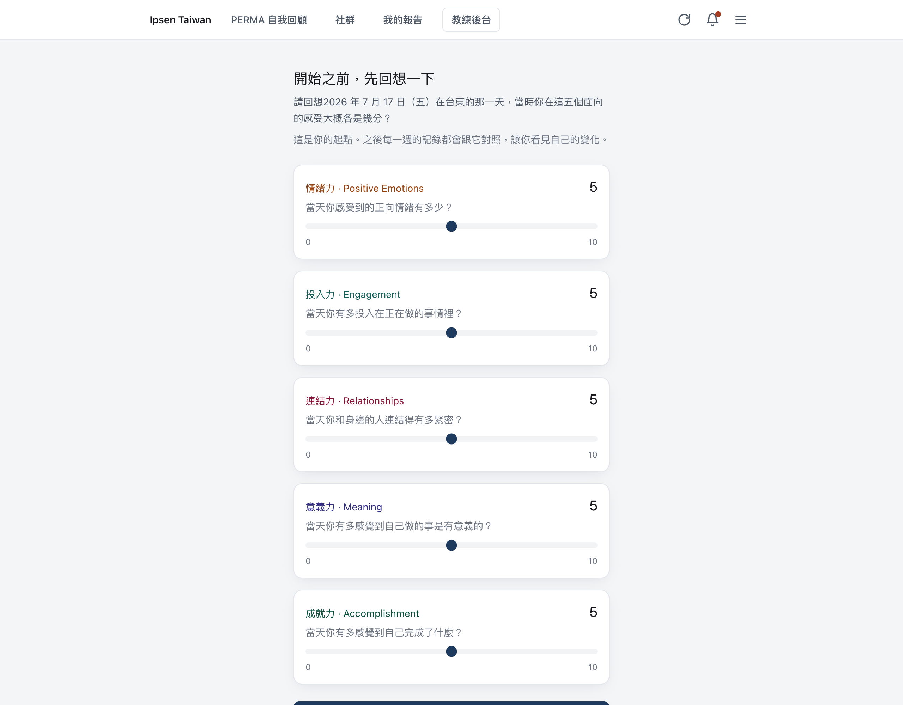
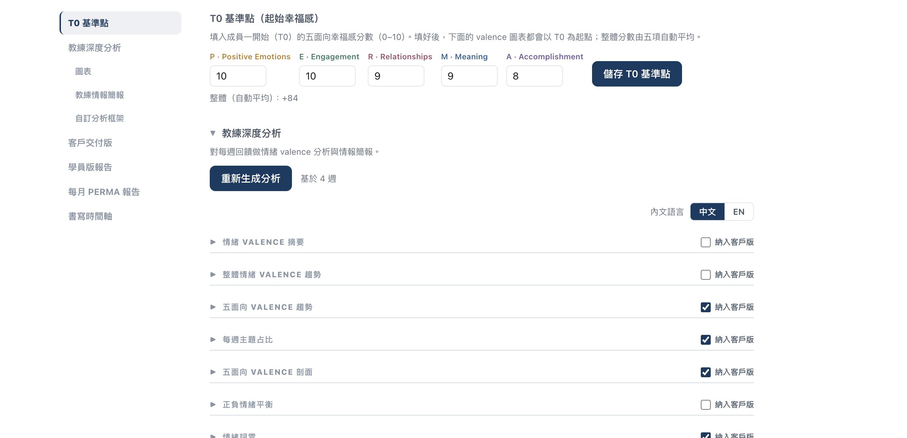
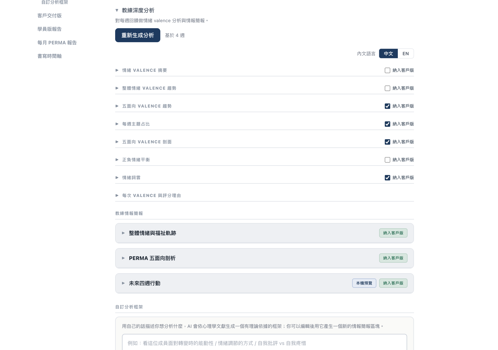
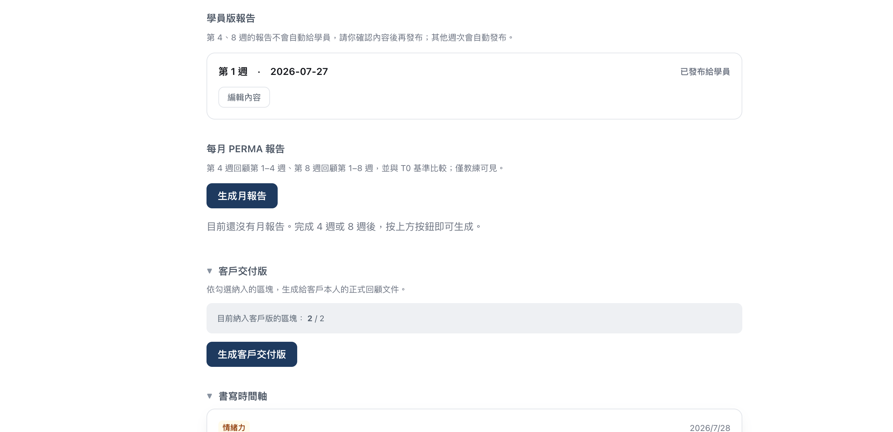
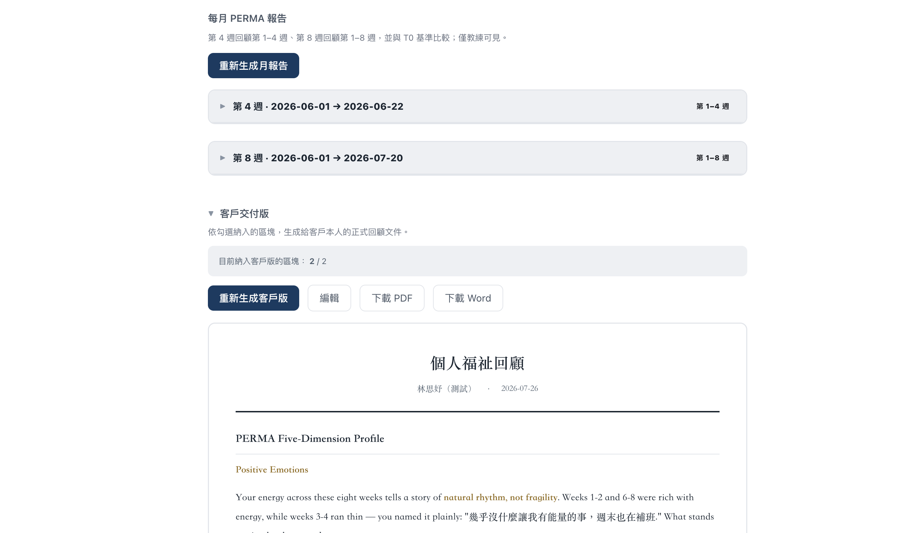

# 報告系統操作說明書

**給教練 Tan Yee Ming ｜ Ipsen Taiwan 八週 PERMA 課程**

這份說明書告訴你：系統會自動幫你做哪些事、哪些事需要你親自處理、以及每一週該做什麼。

---

## 一、先看這一頁就好

八週課程裡，**大部分時間你不需要做任何事**。

| 時機 | 系統自動做 | 你要做 |
|---|---|---|
| 課程開始前 | 學員第一次登入時自己填 T0 起始分數，自動同步到你的後台 | 確認每位學員都填好了 |
| 第 1、2、3 週 | 產生學員報告 → 寄給學員 → 更新你的分析 | 不用做任何事 |
| **第 4 週** | 產生報告，但**先不給學員** | **確認內容 → 按「發布給學員」** （可順便生成月報告） |
| 第 5、6、7 週 | 產生學員報告 → 寄給學員 → 更新你的分析 | 不用做任何事 |
| **第 8 週** | 產生報告，但**先不給學員** | **確認內容 → 按「發布給學員」** （可順便生成月報告、客戶交付版） |

**只有第 4 週和第 8 週需要你動手。** 其餘週次全自動。

---

## 二、T0 起始分數：學員自己填，你只要確認

T0 是整個課程的比較基準 —— 之後所有圖表都以它為起點，
讓你一眼看出「學員從哪裡出發、現在走到哪裡」。

### 這件事系統已經幫你處理好了

**學員第一次登入時，系統會強制他先填 T0，填完才能開始第一次打卡。**

學員看到的畫面是這樣：

- 標題：「開始之前，先回想一下」
- 提問：「請回想 **2026 年 7 月 17 日（五）在台東**的那一天，
  當時你在這五個面向的感受大概各是幾分？」
- 五個面向各填 0 到 10 分
- 頁面下方提醒：「**送出後就不能修改了**，憑當時的印象填就好，不用太精準」

填完後**自動同步到你的教練後台**。你打開成員頁，最上方的
「T0 基準點（起始幸福感）」就已經是填好的狀態，不需要你做任何事。

### 什麼時候需要你動手

只有兩種例外：

| 狀況 | 你要做的事 |
|---|---|
| 學員還沒填（例如還沒第一次登入） | 你可以先代填，圖表才有起點 |
| 需要修改（學員自己改不了） | 直接改數字後按「**儲存 T0 基準點**」 |

操作方式：進入該學員頁面 → 最上方「T0 基準點（起始幸福感）」→
五個面向各填 0 到 10 → 按「儲存 T0 基準點」。

### 五個面向

學員端與教練端用的名稱略有不同，對應如下：

| 代號 | 學員看到的 | 你在後台看到的 | 學員被問的問題 |
|---|---|---|---|
| P | 情緒力 | Positive Emotions | 當天你感受到的正向情緒有多少？ |
| E | 投入力 | Engagement | 當天你有多投入在正在做的事情裡？ |
| R | 連結力 | Relationships | 當天你和身邊的人連結得有多緊密？ |
| M | 意義力 | Meaning | 當天你有多感覺到自己做的事是有意義的？ |
| A | 成就力 | Accomplishment | 當天你有多感覺到自己完成了什麼？ |

### 分數怎麼看

- **5 分 = 中性**（不好不壞）
- 10 分 = 非常好
- 0 分 = 非常低落

填完後，系統會顯示自動換算的整體分數。

> 💡 學員填的是「回想台東那一天的狀態」，不是當下的心情，也不是考試分數。
> 這個回想日期目前固定是 2026/07/17；若之後開新梯次需要改日期，請告知技術窗口。

---

## 三、第 1、2、3、5、6、7 週：完全自動

學員在自己的頁面寫完當週五題後，系統會在**背景自動完成三件事**：

1. **產生學員的個人週報告** — 只根據他這一週寫的內容，用第二人稱寫給他本人
2. **寄 email 給學員** — 附上報告 PDF（含雷達圖、主題占比圓餅圖、情緒詞雲）
3. **更新你的教練深度分析** — 圖表、情報簡報都會自動跟著長出新的一週

**你不需要按任何按鈕。** 進來看就好。

而且就算學員那邊的自動觸發沒跑到（例如他寫完就馬上關掉分頁），
**你一進入該學員的頁面，系統會自己檢查分析有沒有落後**：落後就立刻在背景補跑，
畫面會顯示「正在自動更新分析…」，跑完（約半分鐘）新內容自動出現，你不必重新整理。
「重新生成分析」那顆按鈕只有在你想強制重跑時才需要用。

### 你可以在哪裡看到

進入該學員的頁面，左側有章節導覽：

| 章節 | 你會看到什麼 |
|---|---|
| **教練深度分析** | 跨全部週次的縱向分析（只有你看得到） |
| ├ 圖表 | 情緒起伏趨勢、五面向雷達圖、主題占比、情緒詞雲 |
| ├ 教練情報簡報 | PERMA 五面向剖析、優勢與內在資源等分析區塊 |
| └ 自訂分析框架 | 想從別的理論角度看時使用（見第六節） |
| **學員版報告** | 學員本人收到的那份報告（每週一張卡片） |
| **每月 PERMA 報告** | 第 4、8 週的階段回顧（見第五節） |
| **客戶交付版** | 給學員的正式結案報告（見第七節） |
| **書寫時間軸** | 學員每一篇原文 |

「基於 X 週」會隨學員書寫自動增加 —— 這代表分析已經涵蓋到第幾週。

> ⚠️ 學員寫完後，分析大約需要**半分鐘**才會跑完。如果剛寫完就進來看還沒更新，
> 頁面會顯示「正在自動更新分析…」，跑完會自己換上新內容，不用重新整理。

---

## 四、第 4 週與第 8 週：需要你確認

這兩週是課程的里程碑，報告份量與影響都比較大，**所以系統不會直接寄給學員**，
而是先做成草稿等你確認。

### 操作步驟

1. 進入該學員頁面 → 找到「**學員版報告**」章節
2. 第 4 週（或第 8 週）那張卡片會標示 **「待你確認，學員看不到」**
3. 想修改內容 → 按「**編輯內容**」→ 改完按「**儲存**」
4. 確認沒問題 → 按「**發布給學員**」

按下去之後，系統立刻：
- 讓學員在他的頁面看得到這一週
- 寄出 email 給學員（附報告 PDF）

> ⚠️ **在你按「發布給學員」之前，學員完全看不到這一週的報告，也不會收到信。**
> 如果忘記按，學員就會一直缺這一週。

---

## 五、每月 PERMA 報告（第 4、8 週）

除了單週報告，你還可以生成**跨週的階段回顧**，用來準備會談。

| 報告 | 涵蓋範圍 |
|---|---|
| 第 4 週月報告 | 第 1 到第 4 週 |
| 第 8 週月報告 | 第 1 到第 8 週（完整回顧） |

### 怎麼生成

1. 進入「**每月 PERMA 報告**」章節
2. 按「**生成月報告**」
3. 等待約一分鐘

生成後每份可以展開，會看到：
- **五面向趨勢圖** — 從 T0 到各週的軌跡
- **五面向雷達圖** — T0（虛線）對比最新一次（實線）
- **分析區塊** — 該期間的縱向分析

> 這份報告**只有你看得到**，不會寄給學員。

---

## 六、想從別的角度分析：AI 分析框架

有時候你會想用特定的理論視角看一位學員，例如「他面對轉變時的能動性」或
「自我批評 vs 自我疼惜」。這個功能讓你用自己的話描述，AI 會找出對應的
實證心理學理論並生成分析框架。

### 兩個地方都能用

| 位置 | 分析範圍 | 結果加到哪 |
|---|---|---|
| 「教練深度分析」→ **自訂分析框架** | 全部週次 | 教練情報簡報多一個區塊 |
| 「每月 PERMA 報告」→ 展開某份報告 | 該里程碑涵蓋的週次 | 那份月報告多一個區塊 |

### 怎麼用

1. 進到上述任一位置
2. 找到描述框（教練深度分析在最下方；月報告在展開後）
3. 用自己的話描述你想看什麼，例如：
   > 我想看她面對挫折時的自我批評與自我疼惜傾向
4. 按「**AI 生成分析框架**」
5. AI 會生成一個有理論依據的框架，包含：
   - 框架名稱與**理論出處**（例如 Neff 自我疼惜理論）
   - 分析視角
   - 2 到 5 個觀察維度
   - 參考文獻
6. **你可以直接編輯**任何欄位、增減維度
7. 滿意後按「**用這個框架分析**」

分析完成後會成為報告裡的一個新區塊，標示為「AI 框架」。

> 💡 同一份報告可以加入多個框架，從不同角度累積觀察。

---

## 七、客戶交付版（結案報告）

八週結束後，給學員的正式回顧文件。

### 步驟

1. **先勾選要納入的內容** — 在「教練情報簡報」各區塊勾選「納入客戶交付版」；
   圖表也各自有勾選框
2. 進入「**客戶交付版**」章節，按「**生成客戶交付版**」
3. AI 會把你勾選的內容改寫成給學員本人閱讀的版本：
   - 移除所有假設、臨床推測與風險語言
   - 語氣溫暖、賦能、前瞻
   - 保留並引用學員自己的話
4. 需要調整就按「**編輯**」直接改，或按「重新生成客戶版」
5. 按「**下載 PDF**」或「**下載 Word**」交付

> ⚠️ 客戶交付版的內容**完全取決於你勾選了什麼**。沒有勾選任何區塊就無法生成。

---

## 八、常見問題

### 學員說沒收到報告

依序確認：

1. 進該學員頁面 →「學員版報告」看那一週在不在
2. 如果**卡片標示「待你確認」** → 是第 4 或第 8 週，你還沒按「發布給學員」
3. 如果**根本沒有那一週** → 學員可能五題沒有全部寫完，系統要五題齊全才會產生報告
4. 如果卡片顯示已發布但學員沒收到 → 請對方檢查垃圾信件匣

### 圖表沒有更新 / 顯示「基於 0 週」

代表這位學員還沒有被分析過（例如只填了 T0）。學員寫完一週後會自動補上；
你一開這位學員的頁面，系統也會再檢查一次、落後就直接在背景補跑。
真的等不及，可以到「教練深度分析」按「**重新生成分析**」。

### 我改了學員報告的內容，會被自動覆蓋嗎？

不會。你編輯過的內容會保留。

### 我勾選的「納入客戶交付版」會被洗掉嗎？

不會。系統自動重跑分析時，你的勾選與自訂 AI 框架區塊都會保留。

### 報告可以重新生成嗎？

可以。「重新生成分析」、「重新生成月報告」、「重新生成客戶版」都會用最新資料重跑。
注意每次重新生成都會產生 AI 費用。

### 學員的週記日期不對，報告就是出不來

系統用**固定的課程起始日**換算週次。如果某篇週記的日期落在課程開始之前，
系統會判定它不屬於這八週，不會產生報告。遇到這個狀況請告知技術窗口調整。

---

## 九、每週建議節奏

| 什麼時候 | 做什麼 | 大約花費 |
|---|---|---|
| 課程開始前 | 確認每位學員都已填好 T0（學員第一次登入時自己填） | 每人 1 分鐘 |
| 每週一次 | 進來看新的一週分析，準備會談 | 每人 5 分鐘 |
| 第 4 週 | 確認並發布報告、生成月報告 | 每人 10 分鐘 |
| 第 8 週 | 確認並發布報告、生成月報告與客戶交付版 | 每人 15 分鐘 |

---

## 十、需要協助

遇到系統問題或報告內容有異常時，請聯絡技術窗口，並提供：

- 學員姓名
- 第幾週
- 你看到的畫面（截圖最有幫助）
